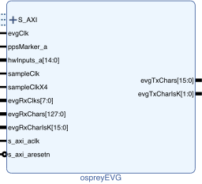

# Osprey EVG

Vivado block design component and driver providing a basic
MRF-compatible event generator.

## Firmware



### Ports

- `s_axi_aclk` Clock for AXI4-lite port.
- `S_AXI` (Clock `s_axi_aclk`)
  AXI4-Lite port.
- evgClk Transmitter clock from multi-gigabit transceiver.
- ppsMarker_a
  Pulse-per second marker.
  The time stamp seconds are incremented and the time stamp ticks cleared on the rising edge of this signal.
  Asynchronous to evgClk, duration must be at least two evgClk cycles.
- hwInputs_a (Clock evgClk)
  Hardware inputs capable of driving distributed bus or triggering on either edge a single event or an event sequence.
  Sampled and synchronized on rising edge of evgClk.
  Duration of asynchronous input triggers must be at least two evgClk cycles.
  Distributed bus values are transmitted on every other evgClk.
- s_axi_aresetn (Clock s_axi_aclk)
  Active-low reset input.
  Resets all firmware.
- sampleClk
  Sampling clock for round-trip latency measurement.
  Typically this operates at 156.25 MHz (6.4 ns interval)
  so one count of the returned value corresponds to a latency of 100 ps.
- sampleClkX4
  Synchronized to, and four times the rate, of sampleClk.
- evgRxClks
  Receiver clocks from multi-gigabit transceivers.
- evgRxChars (Clock evgRxClks\[i\])
  Received characters from multi-gigabit transceivers.
- evgRxCharIsK (Clock evgRxClks\[i\])
  Received character status from multi-gigabit transceivers.
- evgTxChars (Clock evgClk)
  Multi-gigabit transceiver transmit data.
  Event codes and K28.5 alignment commas are sent in the most significant eight bits.
  Distributed bus and distributed data values are sent in the least significant eight bits.
- evgTxCharIsK (Clock evgClk)
  Multi-gigabit transceiver transmit data modifiers.

The size of the sequencer pattern tables and the number of sequencers,
timers and hardware trigger sources are configurable in the block design
editor.
The evgClk frequency must be configured in the block design editor to
the value produced by the multi-gigabit transceiver.

## Software

See documentation comments in `ospreyEVG.h` for usage details.

### Event Sequencer 

There are up to eight event sequencers banks in each event generator.
Each bank of a sequencer is in one of the states shown:

- Idle
  - Completely inactive.  
  - Safe to be updated.
  - Move to Armed with `ospreyEVGSequencerArm()`
- Armed
  - Ready to trigger.
  - Not safe to update.
  - Configure inputs/timers as trigger sources for a bank with
    `ospreyEVGSequencerSetHwTrigger` or `ospreyEVGSequencerSetTimerTrigger()`
    or force trigger zero or more banks with `ospreyEVGSequencerSoftTrigger()`.
  - Move to Idle state with `ospreyEVGSequencerDisarm()`.
- Triggered
  - Ready to run.  Not safe to update.
  - One triggered bank at a time will move to the Active state.
  - Move to Idle state with `ospreyEVGSequencerCancel()`
- Active
  - Sending events.
  - Not safe to update.
  - Move to Idle state with `ospreyEVGSequencerCancel()`
  - Returns to Idle state when address counter overflows,
    or when event 255 is encountered.
  
For example, starting from an idle state, load the following table.
Delays are shown in

| Code | Delay (abs) | Delay (rel) |
| ---: |       ----: |        ---: |
| 15   |           0 |           0 |
| 16   |           1 |           0 |
| 17   |          10 |           8 |
| 255  |          11 |           0 |

```c
ospreyEVGSequencerWriteCode(0, 0, 15);
ospreyEVGSequencerWriteCode(0, 1, 16);
ospreyEVGSequencerWriteCode(0, 2, 17);
ospreyEVGSequencerWriteCode(0, 3, 255);

ospreyEVGSequencerWriteDelay(0. 0, 0);
ospreyEVGSequencerWriteDelay(0. 1, 0);
ospreyEVGSequencerWriteDelay(0. 2, 8);
ospreyEVGSequencerWriteDelay(0. 3, 0);

// trigger first bank on rising edge of first input
ospreyEVGSequencerSetHwTrigger(0, 0, 0x1);

ospreyEVGSequencerArm(0x1); // arm first bank
```


### Error Codes

All the functions mentioned above return -1 if called before
ospreyEVGInit() has been called successfully, and return -2 if an
argument is out of range.

## Event Source Priorities

If multiple event sources make simultaneous requests the event from the
lower priority source will be delayed and emitted at the next free slot,
in most cases.
The event source priorities are:

1. Sequencer events.
1. Timer-driven events.
    1. The first timer (index 0) has the highest priority.
1. Hardware-trigger-driven events.
    1. The first hardware input (index 0 or 1) has the highest priority.
1. Software-requested events.
1. Heartbeat events.
    - If preempted the event is omitted rather than
      being shifted to the next free slot.
1. Pulse-per-second events.
1. Time-of-day updates.
    - There is no problem with these events (112 and 113)
      being delayed as long as all 32 have been sent before the
      next pulse-per-second event.
1. K28.5 8B/10B synchronization character in every fourth slot.
1. Event code 0.

### FEED Support

The FEED JSON file fragment for the event generator I/O is produced by
the ospreyEVG.py script included with the driver.  The script can be
invoked from the command line or from another python script as:

```py
    import ospreyEVG
    ospreyEVG.ospreyEVG_emitJSON(EVG_REG_BASE=1000000, \
                                 timerCount=2, \
                                 hwTriggerCount=8, \
                                 seqBankCount=4, \
                                 seqAddrWidth=11,
                                 rxCount=8)
```

The functions described below are wrappers around the functions
mentioned in the previous section to simplify their use in a FEED driver
environment.

```c
int ospreyEVG_FEEDwrite(int offset, uint32_t value);
uint32_t ospreyEVG_FEEDread(int offset);
```

The offset values are relative to the EVG_REG_BASE in the python script,
so a typical invocation from a FEED driver for the EVG_REG_BASE shown
above might be:

```c
    #define REG_EVG_START                     1000000
    #define REG_EVG_END                         1010000
    // ...
        if ((address >= REG_EVG_START) && (address < REG_EVG_END)) {
            return ospreyEVG_FEEDread(address - REG_EVG_START);
        }
```

The value returned by `ospreyEVG_FEEDwrite()` is 0 if the offset is that
of a supported register and -1 otherwise.

## EPICS

Example EPICS database entries to control the event generator are
included in the distribution.  The entries use a FEED driver and the
LEEP protocol to communicate with the FPGA.  All record names in the
example database begin with the `$(P)` macro.  This prefix is not
included in the record names below.

To include the EPICS database in an EPICS application:

-   Add an OSPREY_EVG entry in the application `configure/RELEASE` or
    `configure/RELEASE.local`.
    The entry should refer to the EPICS directory in the ospreyEVG
    support module.
-   Add two lines to the application `Db/Makefile`:
    `USR_VPATH += $(OSPREY_EVG)/db`
    `DB += ospreyEVG.db`

### Time-of-Day 

The time-of-day seconds is set by writing to the  EVG:setSeconds longout
record.  Once set the seconds value is incremented by each rising edge
of the PPS marker.

### Status 

The EVG:status and EVG:seqStatus longin records hold the status and
sequencer status register contents described above.

### Input Mapping 

The `EVG:MAP:hwTrig` and `EVG:MAP:dbus` longout records set the mapping of
input lines (hwInputs_a) to hardware triggers or distributed bus lines
as described above.

### Heartbeat Events 

The rate at which heartbeat events are generated is the evgClk divided
by by the divisor set by the EVG:hbDivisor longout record.

### Timer-Requested Events 

The rate at which timer-requested events are generated is the evgClk
divided by by the `EVG:TMR:n:divisor` longout records, where n ranges 1 to
the number of timers configured in the firmware.   The event code
emitted is set by the `EVG:TMR:n:event` longout records.

Timers are started, stopped and resumed using the `EVG:TMR:control`
longout record.  The status of all timers is in `EVG:TMR:status`.  The
semantics of the record values are described in the
firmware Timer-requested Events description above.

### Hardware-Triggered Events 

The event code emitted on the rising or falling edge of the signal at
each hardware trigger input is set by the `EVG:TRIG:n:rise` or
`EVG:TRIG:n:fall` longout records where n ranges from 1 to the number of
hardware triggers configured in the firmware.  An event code of 0
disables the associated trigger.

### Software-Triggered Events 

An arbitrary event code is transmitted by writing the code to the
EVG:swEvent longout record.

### Event Sequencer 

Event sequences are a described by a table of delay:event pairs, where
the delay is the number of evgClk ticks to wait before emitting the
specified event.  The number of tables is a firmware configuration value
and ranges from 1 to 8.  Tables are configured by `EVG:SEQ:s:pattern` aao
records, where s is the sequencer to be configured.  The first element
of each pair is delay and the second the event.  The end of a sequence
is indicated by an event code of 255.  It is good practice to configure
at least one clock cycle of delay between sequencer events to minimize
the amount that lower-priority events have to be shifted because an
event slot is being taken by a sequencer event.

Event sequences are armed or disarmed by writing to the `EVG:SEQ:arm` or
`EVG:SEQ:disarm` longout records, respectively.  The value written is a
bitmap specifying the sequencer(s) to be armed or disarmed, with the
least-significant bit corresponding to the first sequencer (1).

Event sequences can be triggered by software by writing to the
`EVG:SEQ:swTrig` longout record.  The value written is a bitmap specifying
the sequencer(s) to be triggered, with the least-significant bit
corresponding to the first sequencer (1).

Event sequence hardware triggering is enabled by setting bits in the
`EVG:SEQ:s:HWrise` or `EVG:SEQ:s:HWfall` longout records, where s is the
sequencer to be triggered by the specified edge of the corresponding
bitmap entry.

Triggering a disarmed sequencer has no effect.

The highest-numbered event sequence has the highest priority. 
Triggering a higher-priority seequencer while a lower-priority sequencer
does not preempt the lower-priority sequence but will start the
higher-priority sequence as soon as the lower-priority sequence
finishes.  If more than one armed sequencer is triggered at any given
time the highest priority armed and triggered sequencer is started. 
When a sequence is started it is automatically disarmed.

An active sequence can be cancelled immediately by processing the
`ospreyEVGSequencerHwTrigger` longout record.
